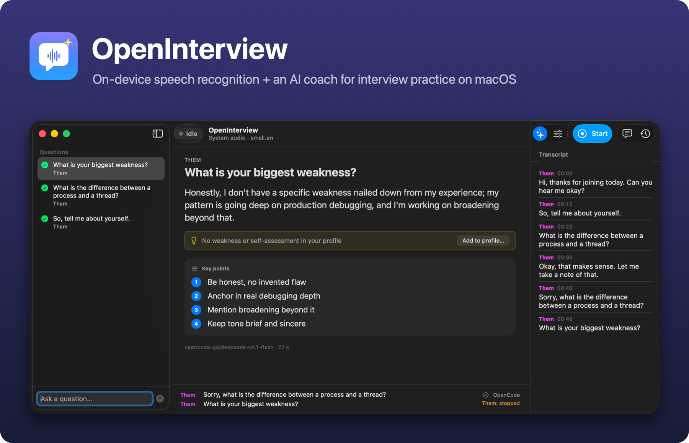

# OpenInterview

**English** · [繁體中文](README.zh-Hant.md) · [日本語](README.ja.md)



Local, low-latency speech recognition and an AI practice coach for job interviews on
macOS (Apple Silicon). It transcribes both sides of a call on-device, spots the
interviewer's questions, and shows a short answer you can say out loud, tailored to your
CV and the job you're interviewing for.

Built for **interview practice, mock interviews and meetings where recording and AI
assistance are permitted**. It is a normal, visible window with a recording indicator: no
hidden overlays, no concealed recording, no screen-share evasion.

## Features

- **On-device speech recognition:** MLX Whisper, NVIDIA Parakeet or Apple's
  SpeechAnalyzer, with live partials and about 1–2 s final latency. No audio leaves the
  Mac.
- **Both sides of the call:** your mic and system audio (Core Audio process tap, or
  BlackHole), with speaker-echo suppression.
- **Question detection:** technical and behavioural questions are picked out, and small
  talk is ignored.
- **AI answers** via [OpenCode](https://opencode.ai) (e.g. DeepSeek) or any
  OpenAI-compatible server. Each answer is a short spoken answer, key points, and code
  when useful.
- **Your profile:** import a CV and the AI organises it. Behavioural answers use only real
  facts, never placeholders. A 💡 hint shows what's missing, with **Add to profile**.
- **Per-interview target:** company, role and job description shape the answers. A
  pre-interview check lists likely questions your profile can't answer yet.
- **Languages:** English, Japanese, Mandarin (Simplified / Traditional) and Cantonese.
- **Session history:** each session can be saved locally (transcript, Q&A, audio), played
  back and deleted. Saving can be turned off.
- **Mock interview test:** a scripted interviewer voice checks the whole chain end to end.

## Quick start

Requirements: an Apple Silicon Mac on macOS 14.2+, plus Xcode or the Command Line Tools.
The Apple recognizer needs macOS 26.

```bash
git clone https://github.com/kuchris/openinterview.git
cd openinterview
scripts/setup.sh            # dependencies, Swift helpers, models, environment check
uv run openinterview app    # open the app
```

Optional: for AI answers, run OpenCode in an empty folder, then turn on **Answers** (✦)
in the app.

```bash
opencode auth login                         # once
mkdir -p ~/opencode-scratch && cd ~/opencode-scratch && opencode serve --port 4096
```

The first capture of system audio asks for macOS's *System Audio Recording* permission.
See [Installation](docs/installation.md).

## Common commands

```bash
uv run openinterview app                       # the app window
uv run openinterview run --source system       # live transcript in the terminal
uv run openinterview -l yue run                # Cantonese (also ja, zh, zh-TW)
uv run openinterview profile import ~/cv.pdf   # build your profile from a CV
uv run openinterview mock --app                # scripted mock interview test
uv run openinterview check --probe             # environment and permission report
```

## Documentation

| | |
|---|---|
| [Installation](docs/installation.md) | Requirements, setup, macOS permissions |
| [Usage](docs/usage.md) | Command line, app window, sessions and history, web dashboard |
| [Practice assistant](docs/assistant.md) | AI answers, your profile and CV, OpenCode setup |
| [Languages](docs/languages.md) | Japanese, Mandarin, Cantonese: models and detection |
| [Architecture](docs/architecture.md) | Pipeline, system audio backends, echo handling |
| [Benchmarks](docs/benchmarks.md) | Latency, accuracy and memory per ASR backend |
| [Testing](docs/testing.md) | Mock interview test and unit tests |
| [PLAN.md](PLAN.md) | Original design and phase plan |

## Privacy

- **Audio** is transcribed on the Mac and never uploaded.
- **Saved sessions** live in `~/.openinterview/sessions/`. Audio recording is a separate
  switch, and both can be turned off.
- **Your profile** (`~/.openinterview/profile.md`) is stored outside the repository.
- **Sent to your AI provider:** detected questions, recent transcript lines, your profile
  and the interview target. Nothing is sent while the assistant is off.
- **Consent:** recording the other side of a call may require their consent. Only use it
  where that's allowed.
